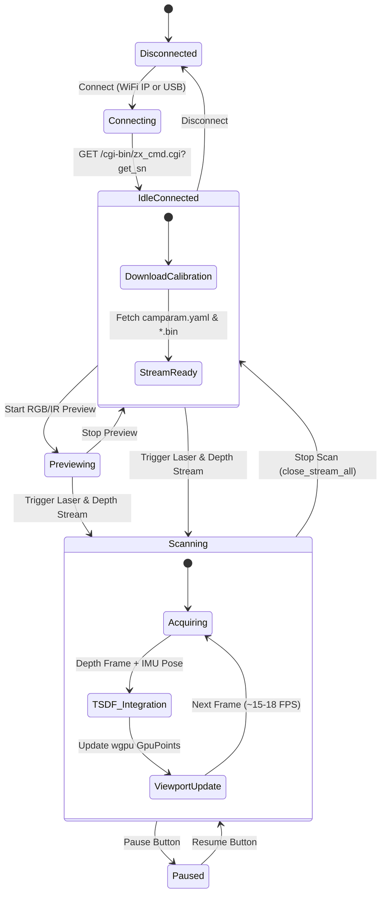

# Revopoint POP 4 Developer Handoff & Implementation Blueprint

> **Historical document.** Written during the first protocol analysis; several statements here were later contradicted by measurement. Current state: [the documentation map](../README.md) and [HANDOFF.md](../HANDOFF.md).

> **Target Audience:** Application developers and agent teammates implementing the custom scanner software suite (`revocraft` in Rust / egui / wgpu or alternative stacks).  
> **Status (corrected 2026-11-01):** Parts of this document were wrong. `camera_id=21` is *not* always depth: its planes depend on `set_depth_output_fmt`/`set_display_type`, and with the settings below it is a raw stereo IR pair. On-device depth needs speckle mode plus fmt 3/type 4 (or fmt 2/type 2), and back-projection must use the rectified `pL` intrinsics. See [captures/2026-11-01-media-stream-layouts.md](captures/2026-11-01-media-stream-layouts.md), which supersedes conflicting statements here.

---

## 1. Quick Technical Reference Cheat Sheet

| Parameter | Specification | Verified Source / Evidence |
|---|---|---|
| **Device Model** | Revopoint POP 4 (`CameraType = 32`) | `3DCamera.dll:?getCameraTypeBySN@cs@@...` |
| **Default IP** | `192.168.178.34` (WiFi client DHCP) / `192.168.179.1` (AP) | Live hardware ARP / ping |
| **Control Plane** | HTTP GET/POST on port `80` (`/cgi-bin/zx_cmd.cgi`) | Lighttpd 1.4.61 daemon |
| **Depth Stream** | HTTP GET `/cgi-bin/zx_media.cgi?camera_id=21` | Rockchip ISP (`/dev/rk_preisp`) |
| **RGB Video Stream** | HTTP GET `/cgi-bin/zx_media.cgi?camera_id=80` (H.264) | 1280x1024 H.264 |
| **Preview Stream** | HTTP GET `/cgi-bin/zx_media.cgi?camera_id=50&type_id=20` | MJPEG preview |
| **IMU Telemetry** | Raw TCP socket on port `9999` (60-byte binary packets at ~138 Hz) | `client/imu.py`, live verified |
| **Binary Framing** | Magic `0xAA55AA55`, 24-byte header, XOR checksum | `client/framing.py`, `0x181249450` |
| **Depth Compression** | **QuickLZ Level 1** Stream Mode (4096 hash entries, 32KB state) | `3DCamera.dll:0x181397850` |
| **Depth Resolution** | $640 \times 512$, 16-bit unsigned integer (`uint16_t` little-endian) | `zx_cmd.cgi?cam_type=mipi&get_depth_reso` |
| **Depth Scale** | **`0.01 mm`** ($10\ \mu\text{m}$ per LSB, e.g. `20000` = $200.0\text{ mm}$) | `3DCamera.dll:0x1812b0bf1`, constant `0x3c23d70a` |
| **Operating Range** | $150\text{ mm} \le Z \le 400\text{ mm}$ (raw: $15,000 \le d \le 40,000$) | Revo Scan 6 depth scan config |
| **Stereo Baseline** | $Tx = -116.800\text{ mm}$ | `camparam.yaml` matrix $T$ |
| **RGB Extrinsics** | Left IR to RGB: $Tx = -24.10\text{ mm}$, $Ty = 0.08\text{ mm}$, $Tz = -2.71\text{ mm}$ | `LC_RT.bin` |

---

## 2. Hardware Lifecycle & State Machine



### 2.1 Handshake Sequence

1. **Verify Connection**:
   ```http
   GET /cgi-bin/zx_cmd.cgi?get_sn
   ```
   *Expected response:* Device serial number string (e.g. `D00000000B0S00E1B`).

2. **Download Calibration Files**:
   ```http
   GET /cgi-bin/zx_cmd.cgi?download=/data/camparam/camparam.yaml
   GET /cgi-bin/zx_cmd.cgi?download=/data/camparam/Prgb.bin
   GET /cgi-bin/zx_cmd.cgi?download=/data/camparam/Distort.bin
   GET /cgi-bin/zx_cmd.cgi?download=/data/camparam/LC_RT.bin
   ```
   Parse intrinsics ($f_x, f_y, c_x, c_y$) and extrinsics ($R, T$).

3. **Start Real-time IMU Stream**:
   Open TCP socket to `<scanner-ip>:9999`. Read 60-byte packets continuously in a background thread to feed visual-inertial odometry.

4. **Start Depth & RGB Stream**:
   - Send control commands:
     ```http
     GET /cgi-bin/zx_cmd.cgi?cam_type=mipi&set_display_reso=1&&set_display_width=1280&&set_display_height=1024&&set_display_type=...
     GET /cgi-bin/zx_cmd.cgi?cam_type=mipi&set_depth_output_fmt=...
     ```
   - Connect HTTP streaming client to:
     ```http
     GET /cgi-bin/zx_media.cgi?camera_id=21
     ```
   - Decompress incoming chunks with QuickLZ Level 1 to produce $(640 \times 512)$ 16-bit depth arrays.

5. **Stop Scan**:
   ```http
   GET /cgi-bin/zx_cmd.cgi?close_stream_all
   ```

---

## 3. Data Structures & Schemas

### 3.1 IMU 60-Byte Telemetry Frame (Port 9999)

```rust
#[repr(C, packed)]
pub struct ImuPacket {
    pub timestamp_ms: u64,       // Device hardware clock
    pub quaternion: [f32; 4],   // [qw, qx, qy, qz]
    pub gyro: [f32; 3],         // [gx, gy, gz]
    pub accel: [f32; 3],        // [ax, ay, az] in Gs (norm ≈ 1.0)
    pub attitude: [f32; 3],     // [pitch, roll, yaw]
}
```

### 3.2 QuickLZ Frame Container

Each depth chunk begins with a QuickLZ header:
- If `(first_byte & 2) == 2`: **9-byte header**
  - Bytes `1..5`: 32-bit compressed size (`u32` little-endian)
  - Bytes `5..9`: 32-bit uncompressed size (`u32` little-endian = $655,360$ bytes)
  - Remaining: QuickLZ Level 1 compressed byte stream.
- Decompresses to a buffer of `640 * 512 * 2 = 655,360` bytes (`&[u16; 640 * 512]`).

### 3.3 3D Point Back-Projection Formula

For each pixel $(u, v) \in [0..639] \times [0..511]$:
```rust
let d_raw = depth_u16[v * 640 + u];
if d_raw >= 15000 && d_raw <= 40000 {
    let z = (d_raw as f32) * 0.01; // millimeters
    let x = (u as f32 - cx) * z / fx;
    let y = (v as f32 - cy) * z / fy;
    // (x, y, z) is the 3D point in millimeters
}
```

---

## 4. Recommended Rust Crates for `revocraft`

| Layer | Subsystem | Recommended Crate | Purpose |
|---|---|---|---|
| **L0** | Vector Math | `glam` or `nalgebra` | SIMD-accelerated 3D vectors, quaternions, $4 \times 4$ matrices |
| **L1** | QuickLZ Decompression | Pure Rust QuickLZ Level 1 module (`revocraft-protocol`) | Lightweight decompression of depth chunks |
| **L1** | HTTP / Networking | `reqwest` (tokio async) or `ureq` | CGI commands and multipart streaming |
| **L1** | USB Interfacing | `hidapi` (HID reports) + `nokhwa` / `windows` (UVC) | USB dual HID + UVC video support |
| **L2** | Odometry & ICP | `kiss-icp` / custom point-to-plane ICP | Real-time scan registration |
| **L2** | Volumetric TSDF | `wgpu` compute shaders | GPU TSDF volume integration for 60+ FPS |
| **L3** | Meshing | `screened-poisson` / `qem` | Watertight surface reconstruction |
| **L4** | Desktop GUI | `egui` + `eframe` | Immediate-mode UI with Solidcraft design tokens |
| **L4** | 3D Viewport | `wgpu` | Point cloud rendering with instanced `GpuPoints` |
| **L5** | Agent Automation | `rmcp` (Model Context Protocol) | AI-driven autonomous scanning |

---

## 5. Working Prototype References in this Repo

- Python Client Core:
  - `client/framing.py`: Full packet framing and XOR checksum.
  - `client/imu.py`: Live IMU reader (60-byte packet decode at 138 Hz).
  - `client/scanner.py`: High-level scanner manager, parameter queries, YAML calibration parser.
  - `client/reconstruction.py`: Depth-to-3D back-projection, valid range masking, PLY exporter.
- Live Verified Scripts:
  - `scripts/live_demo.py`: Connects live to `192.168.178.34`, verifies hardware, downloads calibration, streams 100+ IMU telemetry samples.
- Unit Tests:
  - `tests/test_client.py` & `tests/test_reconstruction.py` (6/6 passing).
