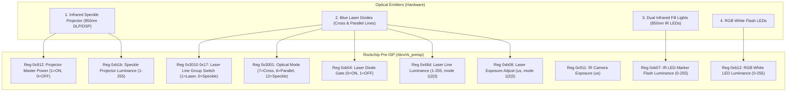
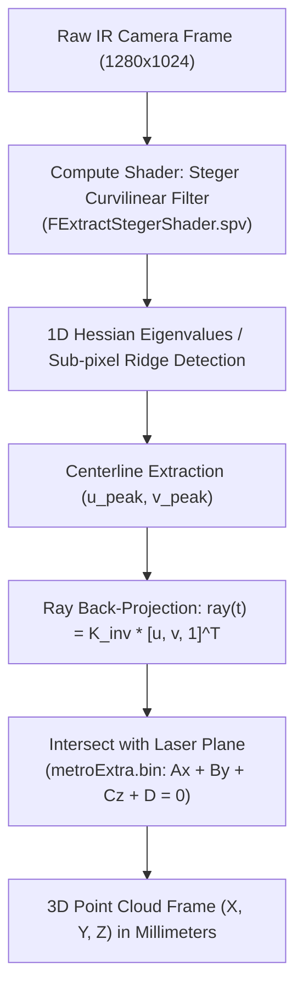
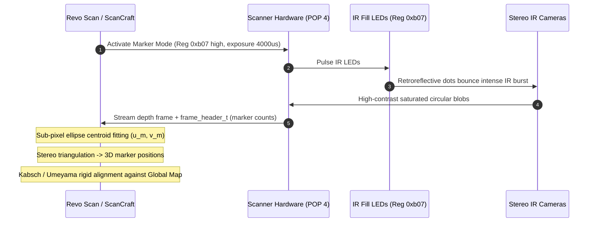

# Laser Emitters, Speckle Projectors & Marker Tracking Pipeline

> **Historical document.** Written during the first protocol analysis; several statements here were later contradicted by measurement. Current state: [the documentation map](../README.md); register meanings in [device-internals.md](device-internals.md) section 4, lasers in [laser.md](laser.md).

This document explains how **Revo Scan** and **`3DCamera.dll`** control the optical emitters (infrared speckle projector, blue cross lasers, parallel laser lines, IR fill lights, and RGB LEDs), how reflected patterns are captured, and how retroreflective marker tracking works on the **Revopoint POP 4**.

---

## 1. Hardware Optical Emitters on the POP 4

Through PE symbol analysis of `3DCamera.dll`, disassembly of the scanner firmware daemon (`zxmain`), and live register testing on the POP 4 hardware (`192.168.178.34`), the scanner contains four distinct optical emitter subsystems:



### 1.1 Complete Hardware Register Map (`/dev/rk_preisp`)

| Register / Command | Mode Argument | Value Range | Driver Function in `3DCamera.dll` | Purpose |
|---|---|---|---|---|
| `0x912` | None | `1` = ON, `0` = OFF | `SensorNetworking::setProperty` | Master power switch for optical projectors |
| `0x3010 0x17` | None | `1` = Enable, `0` = Disable | `cs::Camera::laserLineGroupModeChange` | Hardware switch routing power to blue laser diodes |
| `0x3001` | Optical Mode | `7` = Cross Blue Laser<br>`8` = Parallel Blue Lines<br>`9` = Single Blue Line<br>`11` = Cross Blue (alt)<br>`12` = IR Speckle Projector<br>`14` = Hybrid Mode | `cs::Camera::laserScanLineModeStart`<br>`cs::Camera::laserScanSpeckleStart` | Selects the active pattern projection mode |
| `0xb04` | None | **`1` = emitter ON, `0` = OFF** (corrected 2026-11-01 by live test, see `laser.md` §3; was documented inverted) | `cs::Camera::laserEnableCtrl` | Laser / projector emitter gate |
| `0x48d` | Mode: `1`=Cross, `2`=Parallel, `3`=Single | `1..255` | `cs::Camera::laserLineLumCtrl` | Adjusts blue laser optical output power |
| `0xb08` | Mode: `1`=Cross, `2`=Parallel, `3`=Single | Microseconds (e.g. `1000..15000`) | `cs::dspLaserLineExpAdjust` | Adjusts camera exposure specifically for laser line capture |
| `0xb1b` | None | `1..255` | `cs::Camera::setSpeckleLuminance` | Adjusts infrared speckle pattern intensity |
| `0x911` | None | Microseconds (e.g. `1000..30000`) | `id_msg_cam_set_exposure_time` | Adjusts stereo IR camera exposure time |
| `0xb07` | None | `0..255` | `cs::Camera::irLuminanceCtrl` | Controls high-intensity IR LEDs for marker illumination |
| `0xb12` | None | `0..255` | `cs::Camera::rgbLuminanceCtrl` | Controls white fill LEDs for RGB color texture capture |

*Note: Emitter control commands are delivered either via HTTP CGI (`GET /cgi-bin/zx_cmd.cgi?system_cmd=...`), TCP Port 8871 (`DeviceDataComTcp`), or USB 2nd HID endpoint (`hid_write`).*

---

## 2. Firmware Protocol Opcode Table (`zxmain`)

Reverse-engineered from the internal dispatch table at offset `0xd08d4` in `/vendor/usr/bin/zxmain`:

| Opcode | Hex | Enum Name | Description |
|---|---|---|---|
| `512` | `0x0200` | `id_msg_rt_args_t` | Real-time argument configuration |
| `513` | `0x0201` | `id_msg_set_sys_mode_bypass_t` | Bypass image processing pipe |
| `514` | `0x0202` | `id_msg_set_sys_mode_standby_t` | Standby low-power mode |
| `515` | `0x0203` | `id_msg_set_sys_mode_idle_enable_t` | Enable idle state |
| `516` | `0x0204` | `id_msg_set_sys_mode_idle_disable_t` | Disable idle state |
| `1154` | `0x0482` | `id_msg_proj_create_trigger_t` | Start hardware projector sync trigger |
| `1156` | `0x0484` | `id_msg_proj_stop_trigger_t` | Stop hardware projector sync trigger |
| `1157` | `0x0485` | `id_msg_proj_create_one_trigger_t` | Single-shot frame trigger |
| `1165` | `0x048d` | `id_msg_proj_return_scan_control_t` | Return scan control / laser line luminance |
| `1166` | `0x048e` | `id_msg_proj_set_ld_luma_t` | Set laser diode luminance |
| `1793` | `0x0701` | `id_msg_algo_depth_t` | Onboard depth engine configuration |
| `1794` | `0x0702` | `id_msg_algo_calibration_t` | Load calibration tables into ISP |
| `1795` | `0x0703` | `id_msg_algo_set_resolution_t` | Depth stream resolution ($640 \times 512$ or $1280 \times 1024$) |
| `1797` | `0x0705` | `id_msg_algo_set_output_infrared` | Toggle raw IR stream output |
| `1798` | `0x0706` | `id_msg_algo_set_background_threshold` | Set minimum contrast threshold |
| `1800` | `0x0708` | `id_msg_algo_set_z_range` | Set minimum and maximum depth clipping bounds |
| `2308` | `0x0904` | `id_msg_cam_set_gain_reg` | Set stereo IR camera analog gain |
| `2321` | `0x0911` | `id_msg_cam_set_frame_time` | Set frame time / maximum FPS interval |
| `2322` | `0x0912` | `id_msg_cam_set_exposure_time` | Set stereo IR exposure time |
| `2323` | `0x0913` | `id_msg_cam_set_auto_expo_mode` | Set auto-exposure mode (`1` = auto, `0` = manual) |
| `2329` | `0x0919` | `id_msg_set_depth_scale` | Set depth metric scale factor ($0.01\text{ mm}$) |
| `2821` | `0x0b05` | `id_msg_ld_enable_type_t` | Laser diode enable / master switch |
| `2823` | `0x0b07` | `id_msg_set_ir_led_exposure_time_t` | Set IR exposure time for marker pulse |
| `2824` | `0x0b08` | `id_msg_set_ir_led_luma_t` | Set IR LED flash brightness for markers |
| `2825` | `0x0b09` | `id_msg_set_ld_exposure_time_t` | Set laser diode exposure time |
| `3840` | `0x0f00` | `id_msg_project_set_brightness_t` | Set projector master brightness |
| `3841` | `0x0f01` | `id_msg_dsp_heart_beat_type_t` | DSP watchdog keepalive heartbeat |

---

## 3. Optical Modes & Calibration Files

The POP 4 flash memory stores separate calibration directories for Infrared Speckle and Blue Laser modes:

| Calibration File | Path | Size | Description |
|---|---|---|---|
| **Speckle OpenCV YAML** | `/data/camparam/camparam.yaml` | 2,058 B | Factory stereo calibration for 850nm IR speckle mode ($Tx = -116.80\text{ mm}$, $f = 1484\text{ px}$) |
| **Blue Laser OpenCV YAML** | `/data/camparam_blue/camparam.yaml` | 2,058 B | Factory stereo calibration for 450nm blue laser mode ($Tx = -116.86\text{ mm}$, $f = 1482.67\text{ px}$) |
| **Blue Disparity Matrix** | `/data/camparam_blue/camparamLR/Q.bin` | 64 B | $4 \times 4$ float32 OpenCV disparity-to-depth reprojection matrix $Q$ |
| **Laser Plane Parameters** | `/data/camparam_blue/metroExtra.bin` | 42,624 B | Multi-line laser plane equations and depth-zone polynomial coefficients |
| **Left IR Rectification** | `/data/camparam_blue/mapparamL.bin` | 148 B | Left sensor undistortion and epipolar rectification parameters |
| **Right IR Rectification** | `/data/camparam_blue/mapparamR.bin` | 148 B | Right sensor undistortion and epipolar rectification parameters |

### 3.1 Laser Plane Calibration Structure (`metroExtra.bin`)

`metroExtra.bin` contains 42,624 bytes of factory geometric calibration:
- **Header (32 bytes)**:
  - `0..17`: Serial Number string (e.g. `D00000000B0S00E1B`, null-padded)
  - `18..31`: Timestamp string (e.g. `20260619142306` = June 19, 2026)
- **Data Records (42,592 bytes)**:
  - 665 records of 64 bytes each ($665 \times 64 = 42,592$ bytes).
  - Each record represents 16 little-endian `float32` values.
  - Divided into 133 laser line passes, with 5 depth-segmented zones per line:
    - Zone 0: `[0.00 .. 3.65]`
    - Zone 1: `[3.65 .. 3.90]`
    - Zone 2: `[3.90 .. 4.10]`
    - Zone 3: `[4.10 .. 4.30]`
    - Zone 4: `[4.30 .. 4.50]`
  - Each zone record stores the plane normal $(A, B, C)$, offset $D$, and optical distortion correction coefficients for ray-plane triangulation.

---

## 4. How Reflected Patterns are Captured & Processed

### 4.1 The Structured Light (Speckle) Pipeline

1. **Projection**: DLP/DSP projector casts a fixed pseudo-random dot pattern in the near-infrared spectrum (~850 nm).
2. **Sensor Capture**: Two synchronized global-shutter CMOS sensors (IR Left and IR Right) capture the scene at up to 18 FPS.
3. **Onboard Hardware Disparity**:
   - The scanner's onboard Rockchip Pre-ISP (`/dev/rk_preisp`) rectifies stereo images using `mapparamL.bin` and `mapparamR.bin`.
   - Semi-Global Matching (SGM) calculates dense disparity along epipolar lines.
   - Disparity is converted to 16-bit depth $Z$ ($0.01\text{ mm}$ per unit).
4. **Compression & Stream**: The resulting $640 \times 512$ 16-bit depth array is compressed with **QuickLZ Level 1** and streamed over HTTP `/cgi-bin/zx_media.cgi?camera_id=21`.
5. **Host Reconstruction**:
   $$X = \frac{(u - c_x) \cdot Z}{f_x}, \quad Y = \frac{(v - c_y) \cdot Z}{f_y}$$

### 4.2 Blue Cross Laser & Parallel Line Triangulation Pipeline



1. **Stripe Centerline Extraction (Steger's Algorithm)**:
   - In Revo Scan, Vulkan compute shader `FExtractStegerShader.spv` runs Steger's algorithm (Carsten Steger, 1998) on GPU.
   - Computes image gradient $g = (\nabla_x I, \nabla_y I)$ and Hessian matrix $\mathcal{H} = \begin{pmatrix} I_{xx} & I_{xy} \\ I_{xy} & I_{yy} \end{pmatrix}$.
   - The maximum eigenvalue $\lambda$ yields the normal direction $n = (n_x, n_y)$.
   - Sub-pixel peak offset $t$ along normal $n$:
     $$t = -\frac{n_x I_x + n_y I_y}{n_x^2 I_{xx} + 2 n_x n_y I_{xy} + n_y^2 I_{yy}}$$
     The centerline point is $(u_0 + t \cdot n_x, v_0 + t \cdot n_y)$.
2. **Ray-Plane Triangulation**:
   - For each extracted sub-pixel point $(u, v)$, the optical ray is:
     $$\mathbf{r}(t) = t \cdot \mathbf{K}^{-1} \begin{pmatrix} u \\ v \\ 1 \end{pmatrix}$$
   - Intersecting with calibrated laser plane $\mathbf{n} \cdot \mathbf{P} + D = 0$ from `metroExtra.bin`:
     $$t = -\frac{D}{\mathbf{n} \cdot (\mathbf{K}^{-1} [u, v, 1]^T)}$$
     $$\mathbf{P}_{3D} = \mathbf{r}(t) = (X, Y, Z)$$
3. **Trace Log**: Verified in `3DCamera.dll`:
   `[SDK TRACE] laser points proc successful PCs = %d, markers = %d`

---

## 5. Retroreflective Marker Tracking Pipeline

In **Marker Tracking Mode**, the scanner tracks retroreflective dot stickers ($3\text{ mm}$ or $6\text{ mm}$ diameter) to maintain high-accuracy positional tracking on flat or featureless objects.



### 5.1 Marker Acquisition Process

1. **Illumination Modulation**:
   - IR LED brightness is boosted (`echo s 0xb07 50 > /dev/rk_preisp`).
   - Camera exposure time is decreased (to ~`4000 µs`), plunging normal ambient background geometry into darkness and leaving retroreflective markers as bright white circles.
2. **Sub-Pixel Centroid Detection**:
   - Connected component analysis segments bright circular blobs.
   - Elliptical edge gradient fitting calculates sub-pixel coordinates $(u_{left}, v_{left})$ and $(u_{right}, v_{right})$.
3. **Stereo Marker Triangulation**:
   - Given Left and Right camera projection matrices $P_1$ and $P_2$:
     $$P_{marker} = \text{Triangulate}\Big((u_{left}, v_{left}), (u_{right}, v_{right})\Big) \in \mathbb{R}^3$$
4. **Constellation Registration (Kabsch / Umeyama Algorithm)**:
   - At least 3 non-collinear markers are identified in the current frame and matched to the global marker framework.
   - Solves the optimal rotation $R$ and translation $T$:
     $$\min_{R, T} \sum_{i=1}^M \left\| P_{global, i} - (R \cdot P_{current, i} + T) \right\|^2$$
   - Provides rigid, zero-drift 6-DOF tracking without relying on surface geometric contours.

---

## 6. Validated Control Commands

### 6.1 Activate Blue Cross Laser Mode

```python
# 1. Master power ON
scanner.set_isp_register("0x912 1")
# 2. Switch hardware route to blue laser line group
scanner.set_isp_register("0x3010 0x17 1")
# 3. Select Cross Line optical mode (mode 7)
scanner.set_isp_register("0x3001 7")
# 4. Set Cross Line luminance (mode 1)
scanner.set_isp_register("0x48d 80 1")
# 5. Gate laser diode ON (0 = ON)
scanner.set_isp_register("0xb04 0")
```

### 6.2 Return to Safe Idle

```python
# 1. Gate laser diode OFF (1 = OFF)
scanner.set_isp_register("0xb04 1")
# 2. Disable laser line group
scanner.set_isp_register("0x3010 0x17 0")
# 3. Reset mode to speckle
scanner.set_isp_register("0x3001 12")
# 4. Master power OFF
scanner.set_isp_register("0x912 0")
```
