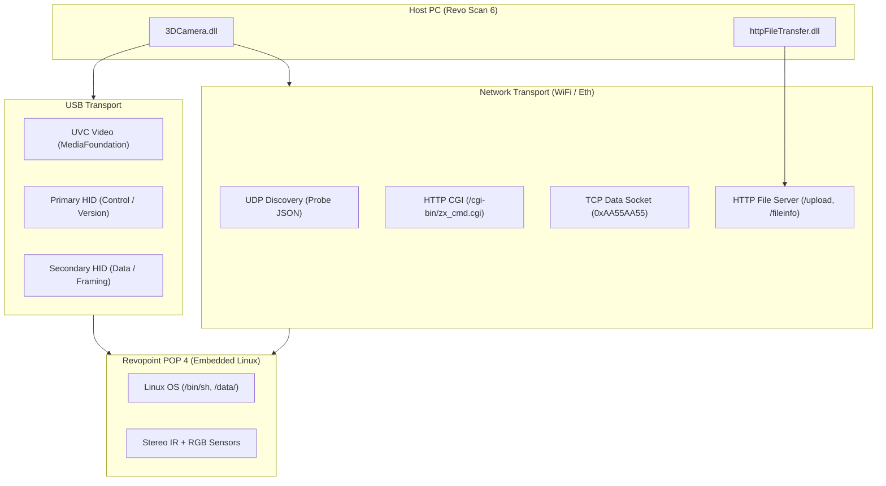

# Revopoint POP 4 Protocol Overview

> **Historical document.** Written during the first protocol analysis; several statements here were later contradicted by measurement. Current state: [the documentation map](../README.md) and [device-internals.md](device-internals.md).

> Confirmed from binary static analysis of `3DCamera.dll`, `httpFileTransfer.dll`, and `scannermgr.dll` (Revo Scan 6.4.1).

---

## 1. System Architecture

The Revopoint scanner runs an **embedded Linux system** with an onboard HTTP daemon, CGI command handlers, video pipeline, and USB gadget stack. The host PC software (`Revo Scan 6` via `3DCamera.dll`) interacts with the device using dual modes:

---

## 2. Transports

### A. USB Transport

The scanner exposes a composite USB device containing at least three interfaces:

1. **UVC (USB Video Class)**:
   - Handled via Windows Media Foundation (`src\usb\mediaFundationWindows\sensor-windows.cpp`).
   - Streams raw or compressed frames from sensor streams (IR left/right, RGB).
   - Uses UVC Extension Units (`KsProperty in getXuData`) for custom vendor controls.
2. **Primary HID Interface**:
   - Device enumeration and configuration via standard HID reports (`hid_open`, `hid_write`, `hid_read`).
   - Querying firmware versions and device status (`DeviceInfo::hidReadHead`, `DeviceInfo::initFirmwareVersion`).
   - Logic stream queries (`SensorLogicStream::hidControlStream`, `SensorLogicStream::GetStreamInfos`).
3. **Secondary HID Interface (Data Communication)**:
   - Filtered by serial number string, selecting the 2nd HID endpoint (`deviceDataComUsbWin.cpp`: `use 2nd path by serial filter (index 1)`).
   - Carries framed packet events wrapped with `0xAA55AA55` magic header and XOR checksums.

### B. Network Transport (Wi-Fi & USB Ethernet)

When connected via Wi-Fi (AP mode `192.168.179.1` or client mode DHCP) or Ethernet (`192.168.3.99`):

1. **Discovery / Probe (UDP)**:
   - `cs::CameraProbeNetWorking::probeThread` broadcasts/listens for UDP probe packets.
   - Devices reply with JSON heartbeat beacons containing:
     - `uniqueId`, `serial`, `firmware`, `algo`, `network_speed`, `boot_mode`.
2. **Control Plane (HTTP REST / CGI)**:
   - HTTP GET requests to `/cgi-bin/zx_cmd.cgi` processed by `cs::sendHttpRequest`.
   - Examples:
     - `/cgi-bin/zx_cmd.cgi?close_stream_all`
     - `/cgi-bin/zx_cmd.cgi?cam_type=usb&&get_resolution=1`
     - `/cgi-bin/zx_cmd.cgi?cam_type=mipi&get_depth_reso`
   - Responses are JSON with a `result: 0` confirmation code.
3. **Data Channel (TCP)**:
   - `cs::DeviceDataComTcp::start`: connects to the scanner's TCP data streaming port.
   - Carries the exact same binary packet protocol (`0xAA55AA55` framing) as the USB 2nd HID interface.
4. **File / Calibration Transfer (HTTP)**:
   - `httpFileTransfer.dll` implements `FileClient` / `FileServer` (cpp-httplib with Basic Auth).
   - Calibration tables located on device:
     - `/data/camparam/mapparamL.bin`
     - `/data/camparam/mapparamR.bin`
     - `/data/camparam/camparamLR/P.bin`, `Q.bin`
     - `/data/camparam/camparam.yaml`
     - `/data/camparam/Pl.bin`, `Prgb.bin`, `Distort.bin`

---

## 3. Data Formats & Compression

1. **Depth Stream**:
   - Compressed using **QuickLZ** (`cs::DecoderDepthQuicklz`, `src\networking\decoder-depth-quicklz.cpp`).
   - Decompressed via `qlz_decompress`.
2. **Video / Color Stream**:
   - Compressed using **H.264** (`cs::DecoderH264` via FFmpeg `avcodec`) or **MJPEG** (`cs::DecoderMpeg`).
3. **POP 4 Specific Chunking**:
   - POP 4 / POP 4 Pro skips gzip compression and uses **0.5 MB / 500 KB chunked splits** (`src\common\deviceDataPacketParser.cpp`).

---

## 4. Detailed Specification Documents

- [framing.md](file:///c:/Projects/3D%20Scanner/docs/protocol/framing.md) — Packet layout, 24-byte header, XOR checksum, QuickLZ Level 1 layout.
- [commands.md](file:///c:/Projects/3D%20Scanner/docs/protocol/commands.md) — HTTP CGI command endpoints, responses, calibration files, and IMU telemetry stream.
- [reconstruction.md](file:///c:/Projects/3D%20Scanner/docs/protocol/reconstruction.md) — Optical coordinate systems, depth scaling ($0.01\text{ mm}$), 3D point back-projection math, and RGB alignment pipeline.
